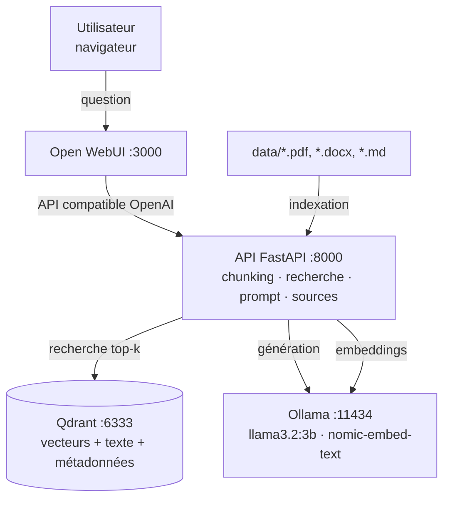
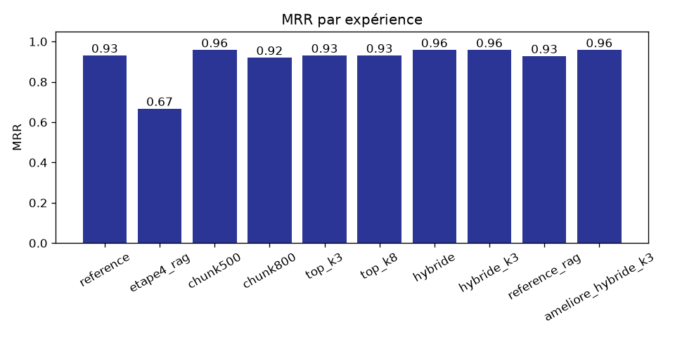

# Assistant RAG local sur mes cours

[](https://github.com/coulibaly-abou/rag-assistant/actions/workflows/ci.yml)


[](LICENSE)

Assistant question-réponse sur mes propres documents de cours (PDF, DOCX, Markdown). Il fonctionne **100 % en local** avec Docker : aucune API payante, aucune donnée envoyée à l'extérieur.

**Stack :** Ollama (`llama3.2:3b`, `nomic-embed-text`) · Qdrant · FastAPI · Open WebUI · Docker Compose

Le système utilise la technique **RAG** (*Retrieval-Augmented Generation*). Avant de répondre, il cherche les passages pertinents dans mes documents. Le LLM rédige ensuite sa réponse **uniquement à partir de ces passages**, en citant le fichier et la page. Si l'information n'est pas dans les documents, il répond « je ne sais pas ».

## Architecture



Le système fonctionne en deux phases :

- **Indexation.** Lecture de `data/` page par page, découpage en chunks de 300 mots avec un chevauchement de 50, calcul des embeddings, puis stockage dans Qdrant avec les métadonnées : fichier, page, matière et empreinte SHA-256. Un fichier inchangé n'est pas réindexé.
- **Question / réponse.** La question est transformée en embedding. On récupère ensuite les *k* chunks les plus proches (similarité cosinus). Le prompt est construit avec des consignes strictes, le contexte numéroté et la question. Le LLM génère la réponse, et les sources sont ajoutées à la fin.

## Installation (3 commandes)

Prérequis : [Docker Desktop](https://www.docker.com/products/docker-desktop/), environ 12 Go d'espace disque et 8 Go de RAM. Aucun GPU n'est nécessaire.

```bash
git clone https://github.com/coulibaly-abou/rag-assistant.git
cd rag-assistant
docker compose up -d
```

Le premier lancement télécharge les images et les modèles, ce qui prend 10 à 20 minutes selon la connexion. Pour suivre l'avancement : `docker compose logs -f ollama-init api`.

| Service | URL |
|---|---|
| Chat (Open WebUI) | http://localhost:3000 |
| API + documentation interactive | http://localhost:8000/docs |
| Tableau de bord Qdrant | http://localhost:6333/dashboard |
| Ollama | http://localhost:11434 |

## Utilisation

### Ajouter mes cours

Place tes fichiers dans `data/`, avec **un sous-dossier par matière** :

```
data/
├── Statistiques/
│   ├── cours_regression.pdf
│   └── td3.docx
└── Programmation/
    └── cours_python.md
```

Lance ensuite l'indexation. Seuls les fichiers nouveaux ou modifiés sont traités :

```bash
curl -X POST http://localhost:8000/ingest
# ou : docker compose exec api python -m app.ingest
```

L'API indexe aussi automatiquement `data/` à chaque démarrage. Le dossier `data/` n'est pas versionné, à l'exception des cours de démonstration `*_demo/` (deux en Markdown, un PDF de 4 pages), qui sont libres de droits.

### Vérifier l'index (recherche manuelle, sans LLM)

```bash
# Contenu de l'index : fichiers, matière, pages, nombre de chunks, empreinte
docker compose exec api python -m app.search --stats

# Passages les plus proches d'une question, avec score, fichier et page
docker compose exec api python -m app.search "Quelle est l'espérance d'une loi binomiale ?" -k 3
docker compose exec api python -m app.search "variance" --matiere Statistiques_demo
```

### Poser des questions

- **Dans Open WebUI** (http://localhost:3000) : crée un compte local au premier lancement, puis choisis le modèle **`rag-cours`**. Pour limiter la recherche à une matière, choisis plutôt **`rag-cours/<matière>`**. Les modèles Ollama « bruts » restent disponibles, ce qui permet de comparer avec le LLM sans RAG.
- **Par l'API** :

```bash
curl -X POST http://localhost:8000/ask -H "Content-Type: application/json" \
  -d '{"question": "Comment calcule-t-on la médiane ?", "matiere": "Statistiques_demo"}'
```

### Endpoints

| Méthode | Route | Rôle |
|---|---|---|
| `POST` | `/ask` | Question → réponse + sources (filtre `matiere` et `top_k` optionnels) |
| `POST` | `/ingest` | Indexe les fichiers nouveaux ou modifiés de `data/` |
| `GET` | `/health` | État d'Ollama et de Qdrant, présence des modèles, nombre de chunks |
| `GET` | `/matieres` | Matières indexées |
| `GET` | `/v1/models` | Compatible OpenAI (pour Open WebUI) |
| `POST` | `/v1/chat/completions` | Compatible OpenAI, avec streaming |

## Configuration

Tous les paramètres se règlent dans un fichier `.env`, à créer à partir de [.env.example](.env.example) : modèles, taille des chunks, top-k, température, etc. Rien n'est écrit en dur dans le code. Après une modification, lance `docker compose up -d`.

La recherche peut fonctionner en deux modes :

- **`SEARCH_MODE=hybrid`** (par défaut, avec `TOP_K=3`) : la recherche sémantique est combinée à une recherche par mots-clés (BM25), et les deux classements sont fusionnés par *Reciprocal Rank Fusion*. Ce mode aide pour les termes exacts : noms de fonctions comme `iloc`, sigles, valeurs comme `68-95-99,7`. C'est la configuration retenue après l'évaluation (voir plus bas).
- **`SEARCH_MODE=vector`** : recherche sémantique seule, par similarité cosinus des embeddings (configuration de référence, avec `TOP_K=5`).

## Évaluation

Le jeu de test se trouve dans [eval/questions.csv](eval/questions.csv), séparé par des points-virgules et modifiable dans Excel. Pour chaque question, il indique la réponse attendue, le fichier et la page attendus, et s'il s'agit d'une question piège hors corpus.

```bash
# Une configuration
docker compose exec api python -m eval.run_eval --tag reference --judge

# Plan d'expériences : référence, puis un seul paramètre changé à la fois
docker compose exec api python -m eval.plan_experiences             # recherche seule (rapide)
docker compose exec api python -m eval.plan_experiences --complet   # + génération + LLM sans RAG

# Graphiques
docker compose exec api python -m eval.plot_results
```

| Métrique | Ce qu'elle mesure |
|---|---|
| Hit Rate@k | Part des questions où le bon passage (fichier, page) est dans les *k* résultats |
| MRR | Moyenne de 1/rang du premier bon passage |
| Fidélité (0-2) | Réponse justifiée par le contexte (LLM-juge local) |
| Pertinence (0-2) | Réponse correcte par rapport à la réponse attendue (LLM-juge local) |
| Refus correct | Part des questions hors corpus où le système répond « je ne sais pas » |
| Faux refus | Part des questions du corpus où le système refuse à tort |
| Latence | Médiane et 95e centile, en secondes |

Chaque exécution ajoute une ligne dans `eval/resultats/experiences.csv`. Le détail question par question est enregistré dans `eval/resultats/details/`. Chaque expérience de découpage utilise sa propre collection Qdrant (`eval_<modèle>_<taille>_<chevauchement>`).

### Résultats

Mesures sur les cours de démonstration (27 questions, dont 3 hors corpus), sur un portable sans GPU. Le détail et l'analyse sont dans le [compte rendu des étapes 6 et 7](docs/etape6_7_evaluation.md).

| Configuration | Hit Rate@k | MRR | Fidélité (0-2) | Pertinence (0-2) | Refus correct | Latence médiane |
|---|---|---|---|---|---|---|
| LLM sans RAG | – | – | – | 1,29 | 0 % | 33 s |
| Référence (vectorielle, 300 mots, k = 5) | 100 % | 0,93 | 0,83 | 0,61 | 100 % | 111 s |
| **Retenue (hybride BM25 + RRF, k = 3)** | **100 %** | **0,96** | **0,92** | **0,83** | **100 %** | **71 s** |

Par rapport à la référence, la recherche hybride avec k = 3 améliore la pertinence de 37 % et réduit la latence médiane de 36 %. Sans RAG, le LLM invente une réponse aux 3 questions hors corpus. Avec RAG, il répond « je ne sais pas » aux 3, sans jamais refuser une question du corpus.



> Le corpus de démonstration est petit et le juge est un modèle 3B : ces chiffres seront à confirmer sur mes vrais cours (30 à 50 questions), avec une notation manuelle sur un échantillon.

## Développement

```bash
pip install -r requirements-dev.txt
ruff check . && ruff format --check .
pytest
```

Les tests utilisent de faux clients et tournent donc sans Docker. La CI GitHub Actions lance ruff, pytest et le build de l'image Docker à chaque push.

Le notebook [notebooks/01_decouverte.ipynb](notebooks/01_decouverte.ipynb) sert à la découverte : embeddings, similarité cosinus calculée à la main et recherche dans Qdrant.

## Structure du projet

```
rag-assistant/
├── docker-compose.yml      # ollama, ollama-init, qdrant, api, open-webui
├── .env.example
├── api/
│   ├── Dockerfile
│   ├── requirements.txt
│   └── app/
│       ├── main.py           # routes FastAPI
│       ├── config.py         # paramètres (.env)
│       ├── loaders.py        # lecture PDF / DOCX / MD
│       ├── chunking.py       # découpage
│       ├── embeddings.py     # embeddings Ollama
│       ├── llm.py            # génération Ollama
│       ├── store.py          # Qdrant
│       ├── ingest.py         # pipeline d'indexation
│       ├── search.py         # recherche manuelle dans l'index (sans LLM)
│       ├── hybrid.py         # recherche hybride BM25 + vecteurs (RRF)
│       ├── rag.py            # recherche + prompt + génération
│       └── openai_compat.py  # /v1/* pour Open WebUI
├── eval/                   # jeu de test, métriques, plan d'expériences, résultats
├── notebooks/              # découverte (étape 2)
├── tests/                  # pytest
├── data/                   # mes cours (non versionnés) + 3 cours de démo
└── docs/                   # cahier des charges, comptes rendus d'étapes
```

Comptes rendus :

- [Cahier des charges](docs/Cahier_des_charges_RAG_local.pdf)
- [Étape 4 — réponses avec et sans RAG](docs/etape4_avec_sans_rag.md)
- [Étapes 6 et 7 — évaluation et amélioration](docs/etape6_7_evaluation.md)

## Dépannage

- **`rag-cours` n'apparaît pas dans Open WebUI.** Open WebUI enregistre sa configuration au premier lancement, et les variables d'environnement peuvent ensuite être ignorées. Ajoute la connexion à la main : *Paramètres d'administration → Connexions → OpenAI*, URL `http://api:8000/v1`, clé `local` (n'importe quelle valeur).
- **Tester `/ask` depuis Windows.** Avec Git Bash, `curl` peut mal encoder les accents. Utilise plutôt la page http://localhost:8000/docs (bouton *Try it out*).
- **Réponses lentes.** Augmente la mémoire allouée à Docker Desktop (*Settings → Resources*), réduis `TOP_K` à 2 ou essaie un modèle plus petit (`LLM_MODEL=qwen2.5:1.5b`).

## Limites

- Les PDF scannés (images) ne sont pas lus, car il n'y a pas d'OCR. Ils apparaissent comme des erreurs dans le rapport d'indexation.
- Un DOCX ou un Markdown n'a pas de pages : ses passages sont tous rattachés à la page 1.
- Sur un portable sans GPU (Docker limité à 8 Go de RAM), une réponse RAG prend en médiane environ 70 secondes avec `llama3.2:3b` et 3 passages de contexte (environ 110 secondes avec 5 passages). C'est au-dessus de l'objectif de 30 secondes. Une machine avec GPU, un contexte plus court ou un modèle plus petit réduisent ce temps.
- Le LLM-juge local (3B) est imparfait : il faut compléter avec une notation manuelle sur un échantillon.
- Dans Open WebUI, seule la dernière question est utilisée pour la recherche. Les questions de relance du type « et pour la variance ? » doivent donc être reformulées.
