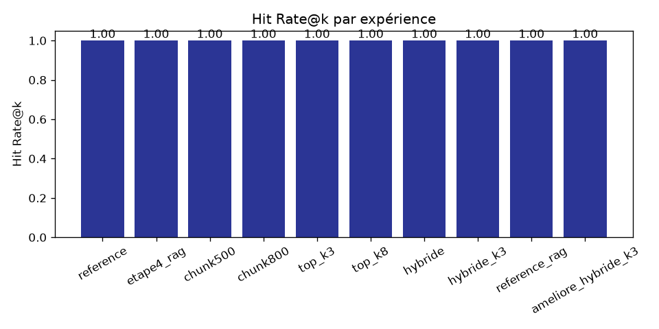
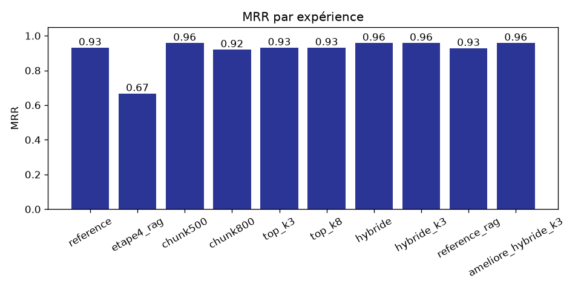
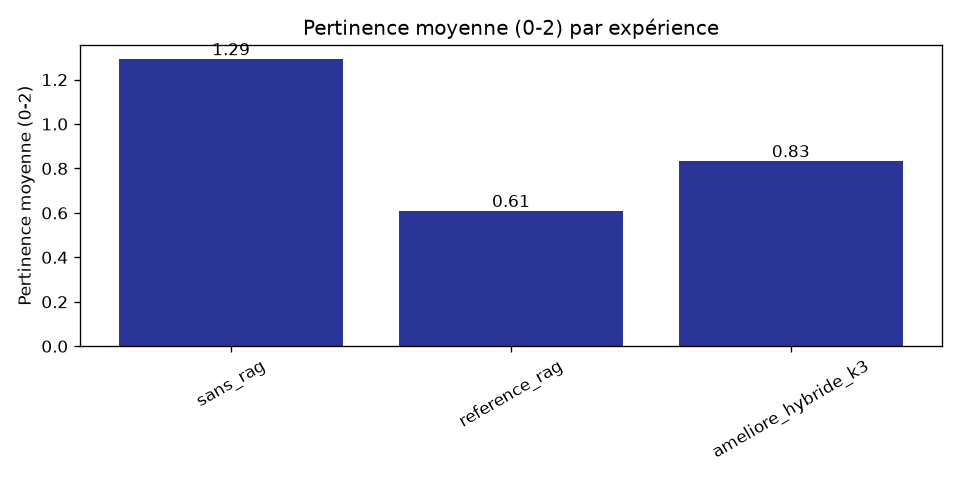
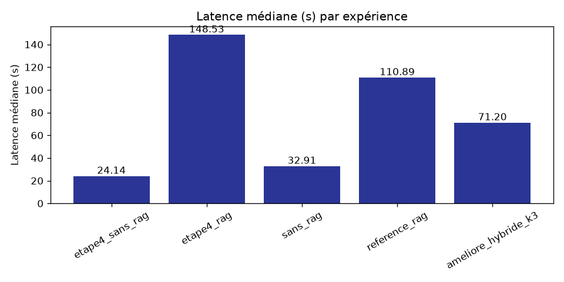

# Étapes 6 et 7 — Évaluation et amélioration

Jeu de test : [eval/questions.csv](../eval/questions.csv). Il contient 27 questions sur les cours de démonstration : 24 questions sur le corpus (16 sur les fichiers Markdown, 8 sur le PDF avec la page attendue) et 3 questions pièges hors corpus.
Machine : portable sans GPU, Docker Desktop. Modèles : `llama3.2:3b` pour la génération et le juge, `nomic-embed-text` pour les embeddings.

## 1. Recherche seule (sans LLM)

Plan d'expériences : on part de la référence et on change un seul paramètre à la fois (`python -m eval.plan_experiences`).

| Expérience | Chunk (mots) | Chevauchement | k | Recherche | Hit Rate@k | MRR |
|---|---|---|---|---|---|---|
| reference | 300 | 50 | 5 | vectorielle | 1,00 | 0,931 |
| chunk500 | 500 | 50 | 5 | vectorielle | 1,00 | **0,958** |
| chunk800 | 800 | 80 | 5 | vectorielle | 1,00 | 0,920 |
| top_k3 | 300 | 50 | 3 | vectorielle | 1,00 | 0,931 |
| top_k8 | 300 | 50 | 8 | vectorielle | 1,00 | 0,931 |
| hybride | 300 | 50 | 5 | hybride (BM25 + RRF) | 1,00 | **0,958** |
| hybride_k3 | 300 | 50 | 3 | hybride (BM25 + RRF) | 1,00 | **0,958** |

- Le bon passage est **toujours** retrouvé (Hit Rate = 1). Le corpus de démonstration est petit, donc ce score sera sans doute plus bas sur les vrais cours.
- La recherche hybride place plus souvent le bon passage **en première position** : le MRR passe de 0,931 à 0,958. Elle aide surtout pour les termes exacts (`iloc`, `68-95-99,7`).
- Des chunks trop gros (800 mots) font baisser le MRR, car un même chunk mélange plusieurs notions.




## 2. Réponses complètes, notées par un LLM-juge

| Configuration | MRR | Fidélité (0-2) | Pertinence (0-2) | Refus correct | Faux refus | Latence médiane | Latence p95 |
|---|---|---|---|---|---|---|---|
| LLM seul, sans RAG | – | 1,04* | 1,29 | **0 %** | 0 % | 33 s | 109 s |
| Référence RAG (vectorielle, k = 5) | 0,928 | 0,83 | 0,61 | **100 %** | 0 % | 111 s | 186 s |
| **Améliorée (hybride, k = 3)** | **0,958** | **0,92** | **0,83** | **100 %** | 0 % | **71 s** | 196 s |

\* Sans RAG, il n'y a pas de contexte. Le juge note alors la fidélité « dans le vide », et ce chiffre n'est pas comparable aux autres.

La référence RAG contient 1 question en erreur sur 27 : Ollama a redémarré par manque de mémoire. Ses moyennes portent donc sur 26 questions.

### Ce qu'on retient

- **Le RAG supprime les inventions hors corpus.** Sans RAG, le LLM répond aux 3 questions pièges en inventant (0 % de refus). Avec RAG, il répond « je ne sais pas » aux 3 (100 %), sans jamais refuser une question à tort.
- **L'amélioration de l'étape 7 est efficace.** On passe à la recherche hybride et on ne garde que 3 passages au lieu de 5 :
  - pertinence **+37 %** (0,61 → 0,83) et fidélité **+11 %** (0,83 → 0,92). Moins de passages, mais mieux classés : le petit modèle 3B se perd moins dans le contexte ;
  - latence médiane **−36 %** (111 s → 71 s), car la machine lit le contexte lentement (environ 16 tokens/s) et un contexte plus court se lit plus vite.
- **La pertinence notée sans RAG (1,29) reste plus haute qu'avec RAG.** Cela vient surtout du juge : `llama3.2:3b` note large les réponses générales et fluides, et sévèrement les réponses courtes centrées sur le cours. L'étape 4, notée à la main sur 5 questions, donnait l'inverse : 2/5 réponses justes sans RAG, 5/5 avec RAG. Le juge doit être complété par une notation manuelle (voir les limites).




## 3. Décision

La configuration retenue est **la recherche hybride avec k = 3** :

```env
SEARCH_MODE=hybrid
TOP_K=3
```

## 4. Limites de l'évaluation

- Le corpus de démonstration est petit (3 fichiers) : il faudra refaire les mesures sur les vrais cours, avec 30 à 50 questions.
- Le juge est le même petit modèle que celui qui répond (3B) : il est biaisé et instable. Il faut le vérifier à la main sur un échantillon.
- La latence dépend beaucoup de la mémoire libre : pendant les mesures, Ollama a manqué de mémoire à plusieurs reprises (erreurs 500, avec reprise automatique).

## Reproduire

```bash
docker compose exec api python -m eval.plan_experiences
docker compose exec api python -m eval.run_eval --mode no-rag --judge --tag sans_rag
docker compose exec api python -m eval.run_eval --judge --search-mode vector --top-k 5 --tag reference_rag
docker compose exec api python -m eval.run_eval --judge --search-mode hybrid --top-k 3 --tag ameliore_hybride_k3
docker compose exec api python -m eval.plot_results
```
